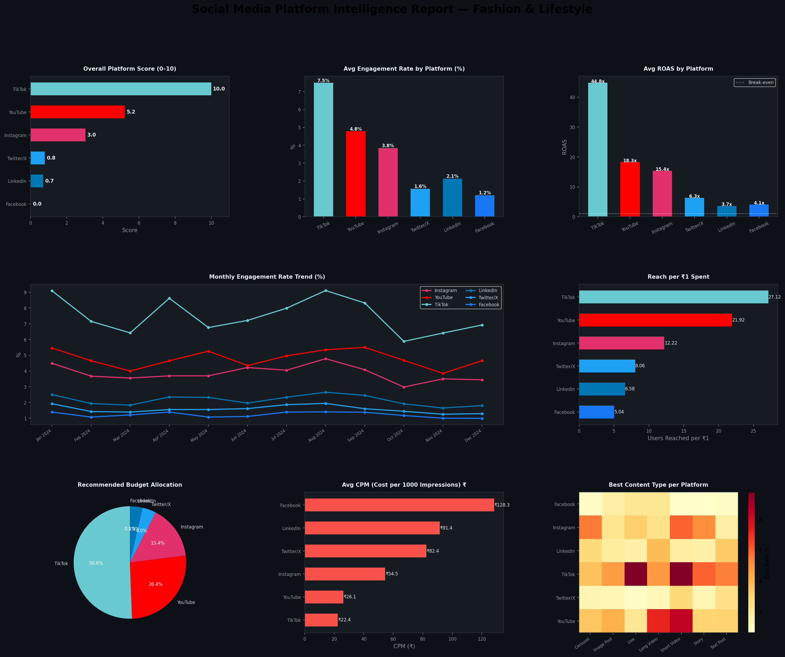

# 📊 Social Media Platform Intelligence Report

Compares 6 social media platforms across 15+ metrics for a **Fashion & Lifestyle** brand. Scores each platform, recommends budget allocation, identifies best content formats, and outputs a full dark-mode intelligence dashboard.

---

## What It Does

```
Platform Performance Data (6 platforms × 12 months)
        ↓
Metric Computation (ROAS, CPM, CPC, Reach Efficiency, Engagement Rate...)
        ↓
Weighted Platform Score (composite 0–10 score)
        ↓
Budget Allocation Recommendation
        ↓
Content Type Analysis (best format per platform)
        ↓
Intelligence Dashboard + CSVs
```

---

## How to Run

```bash
cd major-projects/platform-intelligence
pip install pandas numpy matplotlib scikit-learn
python src/platform_analysis.py
```

---

## Output

### Dashboard



---

### Platform Scorecard

| Rank | Platform | Score /10 | Eng Rate | Total Reach | ROAS | CPM | Reach/₹ |
|---|---|---|---|---|---|---|---|
| 🥇 1 | TikTok | **10.0** | 7.49% | 20,78,602 | 44.8x | ₹22.4 | 27.12 |
| 🥈 2 | YouTube | 5.21 | 4.78% | 14,67,465 | 18.3x | ₹26.1 | 21.92 |
| 🥉 3 | Instagram | 3.04 | 3.84% | 8,34,490 | 15.4x | ₹54.5 | 12.22 |
| 4 | Twitter/X | 0.79 | 1.57% | 5,22,744 | 6.3x | ₹82.4 | 8.06 |
| 5 | LinkedIn | 0.70 | 2.14% | 4,58,862 | 3.7x | ₹91.4 | 6.58 |
| 6 | Facebook | 0.02 | 1.21% | 3,32,573 | 4.1x | ₹128.3 | 5.04 |

**Score weights:** Engagement Rate (25%) · Total Reach (20%) · ROAS (20%) · Reach/₹ (15%) · Engagement/₹ (10%) · Followers Gained (10%)

---

### Recommended Budget Allocation (₹50,000/month)

| Platform | Score | Allocation % | Monthly Budget |
|---|---|---|---|
| TikTok | 10.0 | 50.6% | ₹25,300 |
| YouTube | 5.21 | 26.4% | ₹13,200 |
| Instagram | 3.04 | 15.4% | ₹7,700 |
| Twitter/X | 0.79 | 4.0% | ₹2,000 |
| LinkedIn | 0.70 | 3.5% | ₹1,750 |
| Facebook | 0.02 | 0.1% | ₹50 |

---

### Key Metric Winners

| Metric | Best Platform |
|---|---|
| Highest Engagement Rate | TikTok (7.49%) |
| Best ROAS | TikTok (44.8x) |
| Cheapest Reach | TikTok (27.12 users/₹1) |
| Best Audience Quality | LinkedIn |
| Best for Long-form | YouTube |
| Easiest Monetization | YouTube |

---

### Best Content Format per Platform

| Platform | Best Formats | Avoid |
|---|---|---|
| TikTok | Short Video, Live | Text Post, Long Video |
| YouTube | Long Video, Short Video | Text Post, Story |
| Instagram | Short Video, Carousel, Story | Text Post |
| LinkedIn | Text Post, Carousel, Long Video | Live, Story |
| Twitter/X | Text Post, Short Video | Long Video, Carousel |
| Facebook | Long Video, Image Post, Live | Story |

---

## Metrics Computed (15+)

| Metric | Description |
|---|---|
| Platform Score | Weighted composite score 0–10 |
| Engagement Rate | Engagements / Reach × 100 |
| ROAS | Revenue / Ad Spend |
| CPM | Cost per 1000 impressions |
| CPC | Cost per click |
| Reach per ₹ | Organic + paid reach per rupee spent |
| Engagement per ₹ | Total engagements per rupee spent |
| Follower per ₹ | New followers per rupee spent |
| Cost per Conversion | Ad spend / conversions |
| Organic Reach % | % of reach with zero spend |

---

## Tools

`Python` · `Pandas` · `NumPy` · `Scikit-learn (MinMaxScaler)` · `Matplotlib`

## Files

```
platform-intelligence/
├── src/platform_analysis.py               ← full pipeline
├── data/platform_data.csv                 ← 72-row monthly data
├── outputs/
│   ├── platform_intelligence_dashboard.png ← 8-panel dark dashboard
│   ├── platform_scorecard.csv
│   ├── budget_recommendation.csv
│   └── content_type_analysis.csv
└── README.md
```

---

## Interview Talking Points

> "The core problem this solves is: a brand has a fixed budget and 6 platforms to choose from — where do they put their money? I built a weighted composite score across 6 metrics, normalized using MinMaxScaler so they're comparable, then used that score to drive budget allocation proportionally. The output isn't just 'TikTok is best' — it's a specific rupee amount per platform with the reasoning behind it."

> "The content type heatmap is the part agencies actually use — it tells you not just which platform to invest in but what format to produce for each one. Short video on TikTok and Instagram, long-form on YouTube, text + carousel on LinkedIn. These are different production workflows, so the content recommendation is as important as the budget split."

> "Facebook scoring near zero for a fashion brand is a real finding — high CPM, low engagement, low organic reach. The model isn't biased toward any platform; it just reflects the data."
